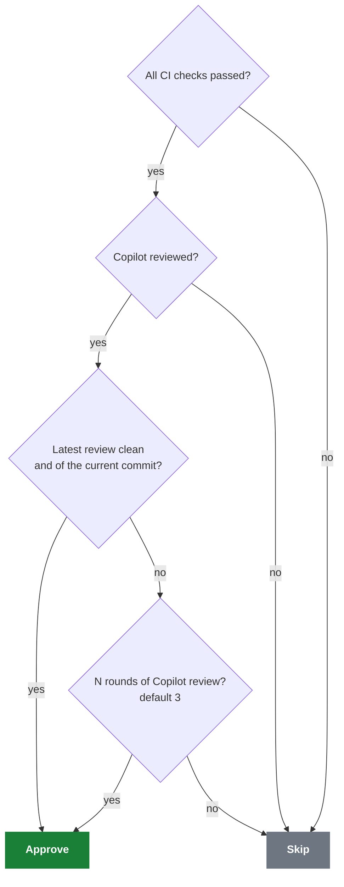
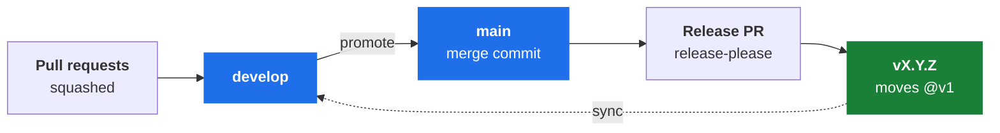

<div align="center">


# PR Auto-Approve (Copilot)

**Merge faster. Let Copilot drive.**

[](https://github.com/marketplace/actions/pr-auto-approve-copilot)
[](https://github.com/SteerSpec/strspc-pr-review/actions/workflows/test-pr-auto-approve.yml)
[](https://github.com/SteerSpec/strspc-pr-review/releases)
[](LICENSE)
[](.nvmrc)

[Why](#why) · [How it works](#how-it-works) · [Prerequisites](#prerequisites) · [Quick start](#quick-start) · [Usage](#usage) ·
[Skills](#claude-code-skills) · [Inputs](#inputs) · [Per-type rounds](#per-type-rounds) · [Troubleshooting](#troubleshooting) ·
[Responsible use](#responsible-use) · [Rules](#rules) · [Releases](#branching-and-releases) · [Development](#development)

</div>

A GitHub Action that approves a pull request, as a bot account, once CI is green and GitHub Copilot's
review is clean. It needs no human click for the rubber stamp, and it is specific about when it
**won't** approve: stale reviews, findings Copilot hid from the inline comments, a failing check, a
changed commit.

## Why

Requiring an approving review on every PR is good policy, but a lot of PRs have nobody meaningful to
ask. Think of a Dependabot bump, a one-line docs fix in an internal tool, or any PR in a repository
with one maintainer, who can't approve their own work because GitHub blocks self-approval. The rule
is doing its job, while the review is a click nobody reads, or a PR that waits days for one.

This action fills that slot with something that looked at the diff. It earns its place on:

| Where | Why |
| ----- | --- |
| **Bot PRs** | Dependabot, Renovate and release automation are high volume and low judgement, and most likely to make a required review feel like a tax |
| **Solo-maintained repos** | A ruleset requires a review nobody is available to give |
| **Internal repos** | The review requirement is org policy rather than a second pair of eyes |

It doesn't belong on anything that matters. It rubber-stamps *Copilot's* verdict, and Copilot isn't a
reviewer for those. Keep `CODEOWNERS` and required human reviewers on sensitive paths: the bot's
approval fills a slot, and it shouldn't be your only gate.

## How it works

The action lets Copilot's review run, then evaluates the PR on every relevant event: a new commit, a
submitted Copilot review, a completed CI check. A caller on `pull_request` also gets `bot-login`
requested as a reviewer when the PR opens. The template runs on `pull_request_target`, so that request
doesn't happen there, and the bot can approve without it.



Every run records a one-line `reason`, also exposed as the [`reason` output](#outputs), saying what
it did. See [Troubleshooting](#troubleshooting).

### What counts as clean

| Check | Why |
| ----- | --- |
| **No inline comments** | Copilot left nothing to resolve |
| **No suppressed-comments block in the body** | Copilot's summary can read as clean while findings sit in a collapsed block, and those comments are absent from the review-comments API, so only a body scan sees them |
| **A clean overview, when the body has one** | Since October 2026 Copilot opens its review body with a verdict such as `🟢 Approval recommended`, then the issues still open across all rounds. The verdict must be `Approval recommended`, the body must state `No open issues`, list no previously missed issue, and collapse only the change summary and resolved issues. Any other verdict, section or wording skips |
| **The review names the current head commit** | A push dismisses the bot's approval under branch protection but leaves Copilot's `COMMENTED` review in place, so without this the new commit would inherit a verdict on the old one. A review with no commit can't prove freshness and is treated the same way |

GitHub has changed the suppressed block's wording at least once (`Comments suppressed due to low
confidence (N)` became `Suppressed comments (N)`), and the action matches both. Treat the markup as
unstable rather than as a contract.

The rounds threshold ignores all of these. It's an unconditional escape hatch, so neither a
suppressed block that never clears nor a missing re-review can wedge a PR forever.

> [!WARNING]
> `rounds-threshold` tunes that escape hatch, so setting it to `1` makes *every* Copilot review
> satisfy it at once. The clean, suppressed-comment and freshness rules are then never evaluated, and
> the action degrades to "approve as soon as Copilot has reviewed at all, on whatever commit". Keep
> it at 2 or higher unless that is what you want.

### What always blocks

- **`CHANGES_REQUESTED`**, regardless of round count.
- **Draft PRs, fork PRs, and PRs targeting another branch.** The action enforces these for every
  event, and the caller's `if:` pre-filters on them so a skipped PR costs no run. The fork guard in
  the caller still matters: it stops a fork-associated run from starting with your secrets at all,
  so keep it if you write your own `if:`.
- **PRs the bot authored**, except in test `sandbox-repos`.

Approvals are idempotent and bound to the head commit. Once the bot holds an `APPROVED` review for
the current SHA the action exits cleanly, and a new push re-triggers evaluation.

## Prerequisites

| You need | Details |
| -------- | ------- |
| **Copilot code review, set to review PRs automatically** | By default the action reads Copilot's verdict and doesn't trigger Copilot itself, so if Copilot never reviews, every run skips with `no Copilot review yet`. Enable it under **Settings → Code review → Copilot**, or with an org or repo ruleset that requests Copilot on PRs. To have the action request the review instead, set [`request-copilot-review`](#copilot) |
| **A dedicated bot GitHub account** | Not your own: GitHub blocks self-approval, so the approving account must differ from PR authors. Add it to the repo as a **collaborator with write access**. Its login is `bot-login` |
| **A fine-grained PAT for that account** | Stored as the `BOT_GITHUB_TOKEN` secret, with **`Pull requests: write` and nothing else**. It posts the approval, which must come from an account that isn't the PR author. The classic-PAT equivalent is `repo`, which also works but grants far more than this action can use |

There's nothing to install: the action runs on `github-script` (Node) inside the Action itself.

Two tokens do different jobs, and the split matters:

| Token | Used for | Needs |
| ----- | -------- | ----- |
| `bot-github-token` | Posting the approval, and dismissing the bot's own approval | `Pull requests: write` |
| [`github-token`](#inputs), default `GITHUB_TOKEN` | Every read: check runs, the PR, its reviews, changed files | `checks: read`, `contents: read`, and `pull-requests: write` for the review request and the dismissal fallback |

Listing check runs needs the **`Checks`** permission, and fine-grained PATs can't be granted it. A PAT
doing the reading works on public repositories, where check runs are readable without it, and fails
with `403` **forever** on private ones. Keep `checks: read` in your caller's job permissions.

## Quick start

**1. Copy the workflow template**

```bash
curl -o .github/workflows/pr-auto-approve.yml \
  https://raw.githubusercontent.com/SteerSpec/strspc-pr-review/main/templates/pr-auto-approve.yml
```

**2. Set the bot login** as an organization or repository variable

```text
STRSPC_PR_AUTO_APPROVE_BOT_LOGIN = <your-bot-account-login>
```

**3. Add the bot token** as an organization or repository secret

```text
BOT_GITHUB_TOKEN = <PAT for the bot, with Pull requests: write>
```

**4. Optionally, add Slack notifications**

```text
SLACK_BOT_TOKEN = <xoxb-... token with chat:write scope>
```

Then open a PR targeting your base branch. Every other setting is optional and also comes from a
variable, see [Organization-wide configuration](#organization-wide-configuration).

## Usage

[`templates/pr-auto-approve.yml`](templates/pr-auto-approve.yml) is the full caller. Copy it rather
than writing your own: its job `if:` and `concurrency` group are load-bearing, and its comments explain
each trap. The shape of it:

```yaml
on:
  pull_request_target:   # NOT pull_request, see the security note below
    types: [opened, ready_for_review, synchronize, reopened, edited]
  pull_request_review:
    types: [submitted]
  check_run:             # third-party app checks only
    types: [completed]
  workflow_run:          # required if your CI is GitHub Actions
    workflows: ['CI']
    types: [completed]

jobs:
  auto-approve:
    runs-on: ubuntu-latest
    permissions:
      pull-requests: write
      contents: read
      checks: read
    # concurrency and if: omitted here, keep them from the template
    steps:
      - uses: SteerSpec/strspc-pr-review@v1
        with:
          bot-login: ${{ vars.STRSPC_PR_AUTO_APPROVE_BOT_LOGIN || vars.PR_AUTO_APPROVE_BOT_LOGIN }}
          bot-github-token: ${{ secrets.BOT_GITHUB_TOKEN }}
          base-branch: ${{ vars.STRSPC_PR_AUTO_APPROVE_BASE_BRANCH }}
          rounds-threshold: ${{ vars.STRSPC_PR_AUTO_APPROVE_ROUNDS_THRESHOLD }}
          # ...one line per setting, see Organization-wide configuration below
          # slack-bot-token: ${{ secrets.SLACK_BOT_TOKEN }}
```

### Organization-wide configuration

The template reads every setting from an Actions variable named `STRSPC_PR_AUTO_APPROVE_<INPUT>`. Set
values once at the organization level (Settings → Secrets and variables → Actions → Variables, or
`gh variable set NAME --org <org> --body <value>`), and override them in a repository with a
repository variable of the same name.

| Variable | Input |
| -------- | ----- |
| `STRSPC_PR_AUTO_APPROVE_BOT_LOGIN` | `bot-login` (required; `PR_AUTO_APPROVE_BOT_LOGIN` still works as a fallback) |
| `STRSPC_PR_AUTO_APPROVE_BASE_BRANCH` | `base-branch` (also drives the job `if:`) |
| `STRSPC_PR_AUTO_APPROVE_ROUNDS_THRESHOLD` | `rounds-threshold` |
| `STRSPC_PR_AUTO_APPROVE_ROUNDS_BY_TYPE` | `rounds-by-type` |
| `STRSPC_PR_AUTO_APPROVE_COPILOT_OPTIONAL_PATHS` | `copilot-optional-paths` |
| `STRSPC_PR_AUTO_APPROVE_ALLOW_NO_CHECKS` | `allow-no-checks` |
| `STRSPC_PR_AUTO_APPROVE_REQUEST_COPILOT_REVIEW` | `request-copilot-review` |
| `STRSPC_PR_AUTO_APPROVE_WAIT_FOR_COPILOT_SECONDS` | `wait-for-copilot-seconds` |
| `STRSPC_PR_AUTO_APPROVE_COPILOT_ERROR_RETRIES` | `copilot-error-retries` |
| `STRSPC_PR_AUTO_APPROVE_SLACK_CHANNEL` | `slack-channel` |

Precedence, highest first: a literal in the caller's `with:`, the repository variable, the
organization variable, the action's default.

> [!IMPORTANT]
> `base-branch` is the exception to that order. The job `if:` reads the variable as well, before the
> action runs, so a literal `base-branch` must also be written into the `if:` (replacing
> `vars.STRSPC_PR_AUTO_APPROVE_BASE_BRANCH || 'main'`), or PRs to that branch are skipped.

- **Overrides replace the whole value.** A repository that wants `fix:` PRs at 2 rounds writes the
  full `rounds-by-type` string (`docs:1,chore:0,fix:2,default:3`), not just `fix:2`.
- **An unset variable means "use the default".** It reaches the action as an empty string, which
  every input treats as its default.
- **To go back to the default in one repository, write the default value explicitly.** GitHub doesn't
  allow an empty variable, so a repo can't "unset" an org value.
- **Org variables have a repository-access policy** (all, private, or selected repositories). A
  variable not granted to a repository reads as unset there.
- **Secrets work the same way.** `BOT_GITHUB_TOKEN` and `SLACK_BOT_TOKEN` can be organization secrets.
- **Existing callers don't pick this up until re-synced**, because the template is copied, not
  referenced. The [`pr-caller-sync`](skills/pr-caller-sync/SKILL.md) skill does that. Create the org
  variables first, or a synced repo runs on the action's defaults (for `base-branch`, that's `main`).
  The deprecated reusable workflow (`.github/workflows/pr-auto-approve.yml`) doesn't read these
  variables.

**Base branches.** `base-branch` takes one branch or a comma-separated set such as `develop,main`, and
whitespace-only falls back to `main`. The template uses `STRSPC_PR_AUTO_APPROVE_BASE_BRANCH` in two
places, the input and the job `if:`, and has no `branches:` filter on the trigger because `on:` can't
read variables. The `if:` check is a substring pre-filter that only saves a runner. It always lets
`main` through, because a whitespace- or comma-only value means `main` to the action, which the `if:`
can't detect. The action enforces the exact set for every event.

### Why `pull_request_target`, not `pull_request`

This workflow holds a bot PAT. For a **same-repo** PR, the `pull_request` event runs the workflow
definition from the PR's **head commit** with your secrets in scope, so anyone who can push a branch
could edit the workflow in their own PR and exfiltrate the token. That token can approve PRs, so
leaking it means self-approving arbitrary changes. `pull_request_target` instead *"runs in the context
of the **default branch of the base repository**"*, so the definition is never PR-controlled. That's
the **default** branch, not the PR's base branch, and they differ whenever a PR targets a non-default
branch.

> [!CAUTION]
> The usual `pull_request_target` warning is about checking out and executing PR code with secrets in
> scope. This action never checks anything out, it only calls the GitHub API, which is what makes the
> swap safe here. **If you add a checkout step, that reasoning no longer holds.** The same goes for
> `pull_request_review`, whose `GITHUB_REF` is the PR **merge ref**: a `checkout` step in that job
> would pull PR code with secrets in scope.

Two consequences:

- **The fork guard becomes load-bearing.** `head.repo.full_name == github.repository` is what stops
  `pull_request_target` running with secrets for a fork-associated PR. Keep it.
- **The bootstrap PR can't approve itself.** The definition comes from the base branch, which doesn't
  have the workflow yet, so the PR that *adds* this file needs a human approval or an admin bypass.
  Every PR after it is handled automatically.

### If your CI is GitHub Actions, you need `workflow_run`

`check_run` alone isn't enough, and the failure is silent. GitHub Actions creates its check runs with
`GITHUB_TOKEN`, and events generated by `GITHUB_TOKEN` never start a new workflow run: that's GitHub's
recursion guard. So `check_run: completed` never fires for your own Actions jobs. It only catches
checks posted by third-party apps.

If Copilot's review lands **before** CI finishes, the review-triggered run skips with `check still
running`, and nothing re-evaluates the PR afterwards. It sits unapproved with no error anywhere. The
`workflow_run` trigger supplies the missing "CI is green now" signal.

Set `workflows:` to the `name:` of **every** workflow that gates PRs. Whichever finishes last is the
run that sees all other checks complete, so one left out is a PR that never gets re-evaluated. Find
them by reading `.github/workflows/`, not by watching what ran on the PR that adds this file: that PR
usually touches only `.github/workflows/`, so a path-filtered workflow stays silent on it and looks
like it doesn't exist. Watch for the array form (`on: [push, pull_request]`) too. The
[`pr-auto-approve-setup`](skills/pr-auto-approve-setup/SKILL.md) skill has the enumeration command.

The template ships all three pieces wired up. Keep both the `workflow_run` branch in the job `if:` and
`github.event.workflow_run.pull_requests[0].number ||` in the concurrency group. The `if:` branch's
`pull_requests[0] != null` check matters: `workflow_run` fires for every completed run of the named
workflow, including non-PR runs such as a push to main, which have an empty `pull_requests` array.
Without the guard those trigger a wasted job run and a noisy "skipped" Slack notification.

### Copilot cannot re-trigger the workflow

`workflow_run` fixes the case where Copilot reviews **before** CI. The mirror case, Copilot reviewing
**after** CI, is the common one, and no trigger can fix it because every signal Copilot could send is
suppressed:

| Signal | Why it never runs the job |
| ------ | ------------------------- |
| `check_run` | Copilot's check run is created with `GITHUB_TOKEN` (recursion guard) |
| `pull_request_review` | The run **is** created, then held at `action_required` pending manual approval |
| `workflow_run` from Copilot's own review workflow | Same actor, so same approval gate |

That second row is a GitHub behaviour change, not a configuration mistake. In our own repo the
identical workflow, event and actor executed normally on 2026-07-25 and was gated on 2026-08-18, with
no enterprise policy, no enabled org Actions policy, and an unchanged fork-PR approval tier. Copilot
has no org membership, and GitHub offers no way to grant it any.

So the wait has to happen inside a run that a non-gated actor started. Set
`wait-for-copilot-seconds`, and the run triggered by **CI completing** polls until Copilot's check
finishes rather than skipping with `check still running`:

```yaml
      - uses: SteerSpec/strspc-pr-review@v1
        with:
          bot-login: ${{ vars.STRSPC_PR_AUTO_APPROVE_BOT_LOGIN || vars.PR_AUTO_APPROVE_BOT_LOGIN }}
          bot-github-token: ${{ secrets.BOT_GITHUB_TOKEN }}
          wait-for-copilot-seconds: '300'   # or set STRSPC_PR_AUTO_APPROVE_WAIT_FOR_COPILOT_SECONDS
```

Since 2026-10 Copilot no longer registers a check run on the head SHA at all: it posts its review from
its own workflow. The same budget therefore also polls the PR's reviews until Copilot has reviewed the
current head, or enough rounds exist for `rounds-threshold`. A run that starts seconds before the
review lands waits for it instead of skipping with `no Copilot review yet`. After a wait the check
runs are fetched again and the CI gates re-applied, so a rerun or a late check still blocks.

It's opt-in (`0` by default) because waiting consumes billable Actions minutes on private repos, and
it's free on public ones. Copilot typically reports within about 3 minutes, so `300` leaves headroom.

Both waits are deliberately narrow:

- The check-run wait only runs while Copilot's check is the **last** one outstanding, so an unrelated
  slow or hung job can't consume the timeout.
- The review wait only starts once every check has completed, and ends as soon as Copilot has
  reviewed the current head.

On expiry the action logs a warning and skips as before. A Copilot check that finishes red is still
caught by the normal failing-check gate, and the gates are re-applied after the review wait.

## Claude Code skills

If you use [Claude Code](https://claude.com/claude-code), this repo ships skills that automate the
setup and the debugging. Both lines are needed: adding the marketplace registers it, and the skills
live in their own cross-linked plugin resolved from this repository at its release tag.

```text
/plugin marketplace add SteerSpec/.claude
/plugin install strspc-pr-review-skills@steerspec
```

| Skill | Use it when |
| ----- | ----------- |
| `pr-auto-approve-setup` | Adding the action to a repo: it walks the prerequisites and the traps above |
| `pr-auto-approve-diagnose` | A PR isn't being approved and you need the `reason` behind it |
| `pr-caller-sync` | The action changed and caller repos need matching updates |

The skills live in [`skills/`](skills/) and are pinned by release tag in the marketplace, so an
installed skill always matches a released version of the action. They're a convenience, not a
requirement: everything they do is documented on this page.

## Inputs

### Required

| Input | Default | Description |
| ----- | ------- | ----------- |
| `bot-login` | | GitHub login of the bot that posts the approval |
| `bot-github-token` | | PAT for `bot-login`, used to post the approval. Needs `Pull requests: write` only |

### Approval rules

| Input | Default | Description |
| ----- | ------- | ----------- |
| `base-branch` | `main` | Base branch(es) PRs must target: one branch or a comma-separated set such as `develop,main` |
| `rounds-threshold` | `3` | Copilot review rounds before approving regardless of inline comments |
| `rounds-by-type` | `''` | Rounds per Conventional Commit type, read from the PR title, such as `docs:1,chore:0,fix:3,default:3`. `0` means Copilot isn't required for that type (approve on green CI). A type below the default applies only when every changed file matches `copilot-optional-paths`. Empty uses `rounds-threshold` for all PRs. See [Per-type rounds](#per-type-rounds) |
| `copilot-optional-paths` | `**/*.md,docs/**/*.md` | Globs. A type mapped below the default (`0` included) applies only when every changed file matches, otherwise the PR uses the default (`default` entry, else `rounds-threshold`). Stops a code change from borrowing a relaxed title |
| `allow-no-checks` | `false` | When `true`, skip the "all checks must pass" gate when no external CI check runs exist for the head SHA, such as docs-only PRs |

### Copilot

| Input | Default | Description |
| ----- | ------- | ----------- |
| `request-copilot-review` | `false` | When `true`, the action requests the Copilot review itself and skips types set to `0` in `rounds-by-type`. Turn off the ruleset's automatic Copilot review first. Failures only warn |
| `copilot-error-retries` | `0` | Times to re-request Copilot's review on the same commit when its review errored ("unable to review this pull request"). Errored reviews never approve or count as rounds. `0` disables, and failures only warn |
| `wait-for-copilot-seconds` | `0` | Seconds to wait for Copilot's review (its check run when it's the **last** check still running, or the review itself when no check run exists) instead of skipping. `0` disables. See [Copilot cannot re-trigger the workflow](#copilot-cannot-re-trigger-the-workflow) |

### Tokens

| Input | Default | Description |
| ----- | ------- | ----------- |
| `github-token` | `${{ github.token }}` | Token used for every **read**: check runs, the PR, its reviews. The default is what makes this work on private repos, see [Prerequisites](#prerequisites) |

### Slack

| Input | Default | Description |
| ----- | ------- | ----------- |
| `slack-channel` | `alert-pr-notifications` | Slack channel for notifications |
| `slack-bot-token` | `''` | Slack bot token (`xoxb-...`) with `chat:write` scope |

### Testing only

| Input | Default | Description |
| ----- | ------- | ----------- |
| `sandbox-repos` | `''` | Comma-separated `owner/repo` list where bot-authored PRs are allowed (e2e only) |
| `test-copilot-logins` | `''` | Extra logins treated as Copilot in sandbox repos (e2e only) |

## Outputs

| Output | Description |
| ------ | ----------- |
| `decision` | `approved`, `skip`, or `error` |
| `reason` | Human-readable explanation |

## Per-type rounds

`rounds-by-type` reads the Conventional Commit type from the **PR title**, the squash-merge title
release-please sees, so `docs` can need 1 round while `fix` needs 3:

```yaml
rounds-by-type: 'docs:1,chore:0,fix:3,default:3'
```

- **`0` means Copilot isn't required.** The PR is approved once CI is green. A Copilot
  `CHANGES_REQUESTED` review still blocks.
- **Unlisted types and non-conventional titles** use `default`, else `rounds-threshold`.
- **Add `edited` to `pull_request_target.types`** in your caller so a retitle re-evaluates the PR.
  Otherwise a `feat:` PR renamed `docs:` keeps its old decision until the next push.
- **To also stop Copilot reviewing those PRs**, disable the ruleset's "Automatically request Copilot
  code review" and set `request-copilot-review: 'true'`. GitHub can't filter automatic reviews by
  title.

### The path gate

The title is author-controlled, so a type mapped below the default (`0` or otherwise) applies only
when **every changed file matches `copilot-optional-paths`**. The default is
`**/*.md,docs/**/*.md`, Markdown only, because a script or generated page under `docs/` is code.
Otherwise the PR gets the default threshold (the `default` entry, else `rounds-threshold`; a `0` is
always gated, so `default:0` falls back to `rounds-threshold` for code), and the `reason` says so:

```text
…; type 'docs' is relaxed to 1 round(s) but the PR touches files outside copilot-optional-paths, so the default 3 applies
```

Types at or above the default are never gated and never list the PR's files. A PR touching 300 or more
files can't prove it's docs-only, because the comparison's file list stops there, and gets the
default rules.

The file list is safe against races:

- It's listed for **exactly the head SHA under evaluation**, through a `heads/<base>...<sha>` commit
  comparison rather than the PR's live file list. A force-push during the run can't swap the diff
  behind the gate, and a tag named like the base branch can't shadow it. This needs `contents: read`
  on `github-token`, which the template grants.
- The base branch and title are re-read with the head before and after approving. When the approval
  rests on the file list, the comparison's **merge base** is re-read too, so a force-push of the base
  branch can't swap the diff either. If anything changed, nothing is approved under the old inputs.

### Withdrawn approvals

The gate is re-applied on every run. An approval's stamp records the threshold it relied on, so a
`docs:1` approval earned on a docs-only diff is withdrawn once a later push adds a code file, and a
retitle that raises the required rounds above the stamp withdraws it too.

- Dismissal tries the bot token first. If GitHub refuses it (401 or 403), it retries with the
  workflow's `GITHUB_TOKEN`, so keep `pull-requests: write` in the caller's job permissions. If
  neither can dismiss it, the run fails (`decision=error`).
- If the file listing itself fails (`403` without `contents: read`, `404` after a force-push), any
  earlier bot approval stamped with a relaxed threshold is withdrawn before the run reports the
  failure.

## Troubleshooting

Not approving? Every run logs a `reason`, also available as the `reason` output.

### Waiting on Copilot

| `reason` | Cause and fix |
| -------- | ------------- |
| `no Copilot review yet` | Copilot hasn't reviewed the PR. Enable **automatic Copilot code review**, see [Prerequisites](#prerequisites) |
| `no Copilot review yet (its last attempt errored; …)` | Copilot's run failed ("unable to review this pull request"), and that review is ignored, not counted as clean. The text after `;` says whether the action re-requested it (`copilot-error-retries`), ran out of retries, or you should re-request it by hand |
| `latest Copilot review requested changes` | Copilot posted `CHANGES_REQUESTED`, which always blocks. Address the feedback and push |
| `latest Copilot review has N comments` | Copilot left inline comments and the round count is below `rounds-threshold` (default 3). Resolve them, or let more rounds accrue |
| `latest Copilot review has N suppressed comment(s)` | Copilot's summary looked clean but it hid findings in a collapsed suppressed-comments block in the review body. Open the review, expand the section, and act on it, or let more rounds accrue |
| `latest Copilot review has verdict '…'`<br>`lists N open issue(s)`<br>`lists a previously missed issue`<br>`has section '…'`<br>`does not state no open issues` | The review's overview doesn't show it as clean, even with no new inline comments. Read the review body, fix or resolve what it lists, and push for a new review, or let more rounds accrue. A verdict or section you don't recognise may mean Copilot changed its wording |
| `latest Copilot review is for an older commit (...)` | You pushed after Copilot reviewed, so its verdict predates the current head. Wait for Copilot to re-review the new commit |
| `latest Copilot review has no commit_id...` | The review carries no commit, so it can't be tied to the head. This is unexpected from real Copilot reviews, so check the reviewer really is Copilot and not a synthetic review posted without a `commit_id` |

### Waiting on CI

| `reason` | Cause and fix |
| -------- | ------------- |
| `check still running: <name>`<br>`no checks on head SHA yet` | CI hasn't finished. The action re-runs when it completes: through `workflow_run` for GitHub Actions CI, or `check_run` for third-party checks. If it never re-runs, see [If your CI is GitHub Actions](#if-your-ci-is-github-actions-you-need-workflow_run) |
| `failing check: <name> (<conclusion>)` | That check didn't pass. Fix CI: approval requires all checks green |

### The PR changed during the run

| `reason` | Cause and fix |
| -------- | ------------- |
| `head moved from … during evaluation`<br>`PR base changed from … during evaluation`<br>`PR title changed during evaluation…` | The PR's head, base branch or title changed while the run evaluated it, so nothing was approved under the stale inputs. The next run (push, retarget or `edited` event) re-evaluates. Expected and rare |
| `PR converted to draft during evaluation` | The PR became a draft during the run, so no approval was posted. Mark it ready for review, and the template re-evaluates on `ready_for_review` |
| `PR head, base, title or draft state changed while approving; approval withdrawn` | The same race, landing between the final re-read and the approval. The approval was posted and immediately dismissed, and the next run re-evaluates |
| `base <branch> was rewritten (merge base … -> …) during evaluation`<br>`… while approving; approval withdrawn` | The base branch was force-pushed while the run evaluated a relaxed type, so the diff the path gate judged is no longer the PR's diff. Nothing is approved, or the approval is dismissed, and the next run re-evaluates. A base that merely moved on through unrelated merges keeps its merge base and doesn't trigger this |

### Relaxed types

| `reason` | Cause and fix |
| -------- | ------------- |
| `…; type '<type>' is relaxed to N round(s) but the PR touches files outside copilot-optional-paths, so the default M applies` | The title's type is below the default in `rounds-by-type`, but the diff reaches outside `copilot-optional-paths`, so the default rules apply. The text before `;` is the ordinary reason under those rules. Expected for a code change with a relaxed title, otherwise widen the globs |
| `evaluation failed: 403 … /compare/…`<br>`evaluation failed: 404 … /compare/…` | The changed-files listing for a relaxed type failed. A `403` means the **read** token lacks `contents: read`, so restore it in the caller's job permissions. A `404` means the evaluated head SHA is no longer on the PR after a force-push, and the next run re-evaluates the new head. Either way any earlier bot approval stamped with a relaxed threshold is **withdrawn first** (`Withdrawn: the changed files of … could not be listed …`) |
| `could not list the PR's reviews, so an earlier approval stamped with a relaxed rounds-by-type threshold cannot be found and withdrawn: …` | The job fails on purpose (`decision=error`): a skip would leave such an approval standing unseen. It's usually transient (rate limit, 5xx), so re-run the job. A persistent `403` means the **read** token can't read pull requests |

### Tokens and configuration

| `reason` | Cause and fix |
| -------- | ------------- |
| `evaluation failed: 403 … /check-runs` | The **read** token can't list check runs. Reads must use the workflow's `GITHUB_TOKEN` (the `github-token` input, default) and the caller must grant `checks: read`, because a fine-grained PAT can't be given the `Checks` permission. This fails **only on private repositories**, so it works everywhere you'd think to test it |
| `bot-login is empty: set the STRSPC_PR_AUTO_APPROVE_BOT_LOGIN organization or repository variable…` | The job fails on purpose. A blank `bot-login` also disables the caller's `github.actor != (vars.STRSPC_PR_AUTO_APPROVE_BOT_LOGIN \|\| …)` loop guard, so each approval would re-trigger the workflow. Set the variable at org or repo level, check an org variable's repository access, or hard-code the login in both places |
| `PR base ref '...' not in [...]`, optionally prefixed `check_run:` or `workflow_run:` | The PR targets a branch outside `base-branch`. Check `STRSPC_PR_AUTO_APPROVE_BASE_BRANCH` at repo and org level, see [Organization-wide configuration](#organization-wide-configuration) |
| Nothing runs at all | Confirm `BOT_GITHUB_TOKEN` belongs to `bot-login` with write access, and that `STRSPC_PR_AUTO_APPROVE_BOT_LOGIN` (or the older `PR_AUTO_APPROVE_BOT_LOGIN`) is set so the review-loop guard works. If the PR's base branch isn't in `STRSPC_PR_AUTO_APPROVE_BASE_BRANCH` (default `main`), the job `if:` skips it |

### Expected skips

| `reason` | Cause and fix |
| -------- | ------------- |
| `triggered by the bot's own review` | The run was started by the bot's approval and exits without evaluating. If you see many of these, the `if:` loop guard doesn't match `bot-login` |
| `PR author is the bot itself` | The bot can't approve its own PR, except in `sandbox-repos` |

## Responsible use

This action rubber-stamps **Copilot's** verdict, and it isn't a substitute for human judgment where
that matters.

- **Keep required human reviewers** (branch protection, `CODEOWNERS`) on sensitive paths. The bot's
  approval fills a review slot but shouldn't be your only gate.
- **Make any check that must block a merge a required status check** in your branch protection or
  ruleset. The action reads your checks when it approves and doesn't enforce them afterwards: a check
  that fails later on the same commit, such as a PR title check after a retitle or a re-run, leaves
  the approval in place. The action withdraws a stamped bot approval when a retitle or a push raises
  the PR's rounds threshold above the stamp, but a failing check on its own never does.
- **Treat `BOT_GITHUB_TOKEN` like any write-scoped credential.** Keep it in secrets, give it
  **`Pull requests: write` and nothing more**, and rotate it periodically.

## Rules

This repository is the `dev.steerspec.prreview` realm. [`rules/APPROVE.json`](rules/APPROVE.json)
states what the approval logic must guarantee, so a behaviour change in `decide.js` goes with a rule
change. All rules are Draft today.

Edit them only through the [`strspc` CLI](https://github.com/SteerSpec/strspc-CLI), never by hand, so
versions and hashes stay consistent. Use a `chore(rules):` title for a rule-only PR.

## Branching and releases



1. Pull requests target `develop` and are squashed. The commit takes the PR title when a PR has
   several commits, and the commit's own subject when it has one, so CI requires a one-commit PR's
   title to match that subject.
2. A `chore: promote develop to main` pull request carries the bundle to `main`. Merge it with a
   **merge commit**, so [release-please](https://github.com/googleapis/release-please) sees each
   commit.
3. release-please opens a release pull request against `main`. Merging it tags `vX.Y.Z`, following
   [semver](https://semver.org/), and moves `@v1`.
4. A sync pull request brings the release commit back to `develop`.

Title types set the version:

| Change | Title | Version |
| ------ | ----- | ------- |
| New capability | `feat:` | minor |
| Fix | `fix:` | patch |
| Docs and chores | `docs:`, `chore:` | no release |
| Rule-only change | `chore(rules):` | no release |

`@v1` always points at the latest `v1.x` release, so pinning it receives patches and
backward-compatible features automatically. Pin an exact `@vX.Y.Z` to upgrade manually.

## Development

Node 22 (`.nvmrc`).

```bash
npm install
npm test               # 221 unit tests, no external dependencies
npm run test:coverage  # same tests + coverage gate (80% line / 70% branch)
npm run lint           # actionlint (workflows) + shellcheck (e2e scripts) + issue-form schema
```

`npm run lint` shells out to `actionlint`, `shellcheck` and `python3`, so install those separately.
The unit tests need none of them. End-to-end tests run against a sandbox repo: see
[`e2e/pr-auto-approve/README.md`](e2e/pr-auto-approve/README.md).

### Layout

```text
strspc-pr-review/
├── action.yml                        # composite Action entry point
├── scripts/
│   ├── pr-auto-approve/
│   │   ├── decide.js                 # all approval rules
│   │   ├── decide.test.js            # unit tests (Node native test runner)
│   │   ├── docs.test.js              # guards this README against drifting from action.yml
│   │   ├── skills.test.js            # guards skills/ against drifting from action.yml
│   │   └── template.test.js          # guards the template against drifting from action.yml
│   └── validate-issue-forms.py       # GitHub drops a malformed issue form silently
├── templates/
│   └── pr-auto-approve.yml           # copy-paste starter for caller repos
├── rules/                            # the dev.steerspec.prreview realm
├── skills/                           # Claude Code skills, published via SteerSpec/.claude
│   ├── pr-auto-approve-setup/
│   ├── pr-auto-approve-diagnose/
│   └── pr-caller-sync/
├── e2e/pr-auto-approve/              # end-to-end harness against a real sandbox repo
└── .github/
    ├── ISSUE_TEMPLATE/               # bug report and feature request forms
    ├── dependabot.yml                # keeps the SHA-pinned actions and dev deps current
    └── workflows/
        ├── auto-approve.yml          # this repo running the action on itself
        ├── pr-auto-approve.yml       # reusable workflow, deprecated, kept for compatibility
        ├── test-pr-auto-approve.yml  # CI: tests, actionlint, shellcheck, issue forms, PR title
        ├── release-please.yml        # semver tagging on main
        └── sync-marketplace-pin.yml  # moves the skills pin in SteerSpec/.claude on release
```

## Contributing

Follow [Conventional Commits](https://www.conventionalcommits.org/), which the commit hook enforces.
Branch from `develop` and open your PR against `develop`, because `main` only receives release
promotions.

- [Contribution guide](https://github.com/SteerSpec/.github/blob/main/CONTRIBUTING.md)
- [Code of conduct](https://github.com/SteerSpec/.github/blob/main/CODE_OF_CONDUCT.md)
- [Security policy](https://github.com/SteerSpec/strspc-pr-review/security/policy): report
  vulnerabilities privately, never as a public issue

## License

Apache 2.0, see [LICENSE](LICENSE).
