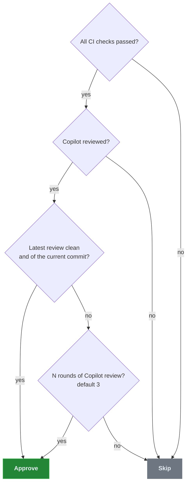

# How it works

When the action approves a pull request, when it skips, and why. Back to the [README](../README.md).

## Why

Requiring an approving review on every PR is good policy, but a lot of PRs have nobody meaningful to
ask. Think of a Dependabot bump, a one-line docs fix in an internal tool, or any PR in a repository
with one maintainer, who can't approve their own work because GitHub blocks self-approval. The rule
is doing its job, while the review is a click nobody reads, or a PR that waits days for one.

This action fills that slot with something that looked at the diff. It earns its place on:

| Where | Why |
| ----- | --- |
| **Bot PRs** | Dependabot, Renovate and release automation are high volume and low judgement, and most likely to make a required review feel like a tax |
| **Solo-maintained repos** | A ruleset requires a review nobody is available to give |
| **Internal repos** | The review requirement is org policy rather than a second pair of eyes |

It doesn't belong on anything that matters. It rubber-stamps *Copilot's* verdict, or mechanical proof
that a promotion or release PR holds nothing new to review, and neither is a reviewer for those. Keep
`CODEOWNERS` and required human reviewers on sensitive paths: the bot's approval fills a slot, and it
shouldn't be your only gate.

## How it works

The action lets Copilot's review run, then evaluates the PR on every relevant event: a new commit, a
submitted Copilot review, a completed CI check. A caller on `pull_request` also gets `bot-login`
requested as a reviewer when the PR opens. The template runs on `pull_request_target`, so that request
doesn't happen there, and the bot can approve without it.

Every run records a one-line `reason`, also exposed as the [`reason` output](inputs.md#outputs), saying what
it did. See [Troubleshooting](troubleshooting.md#troubleshooting).

### What counts as clean

| Check | Why |
| ----- | --- |
| **No inline comments** | Copilot left nothing to resolve |
| **No suppressed-comments block in the body** | Copilot's summary can read as clean while findings sit in a collapsed block, and those comments are absent from the review-comments API, so only a body scan sees them |
| **A clean overview** | The action reads Copilot's overview format: the review body opens with a verdict such as `🟢 Approval recommended`, then the issues still open across all rounds. The verdict must be `Approval recommended`, the body must state `No open issues`, list no previously missed issue, and collapse only the change summary and resolved issues. Any other verdict, section or wording skips, and so does a body with no overview at all, including an empty one or the older `generated no new comments` summary. [`copilot-clean-on`](inputs.md#approval-rules) can also pass `Needs a closer look`; see [Passing Needs a closer look](#passing-needs-a-closer-look) |
| **Copilot reviewed something** | Copilot also posts a review when it reviewed nothing. When its run failed or the requester ran out of quota, the review is ignored. When every changed file is excluded from review (`Copilot wasn't able to review any files`, even under a green verdict), it stays the latest review and blocks a copilot-clean approval. Neither counts as a round. Like any review, neither stops the rounds rule once enough real rounds exist |
| **The review names the current head commit** | A push dismisses the bot's approval under branch protection but leaves Copilot's `COMMENTED` review in place, so without this the new commit would inherit a verdict on the old one. A review with no commit can't prove freshness and is treated the same way |

GitHub has changed the suppressed block's wording at least once (`Comments suppressed due to low
confidence (N)` became `Suppressed comments (N)`), and the action matches both. Treat the markup as
unstable rather than as a contract.

The rounds threshold ignores all of these. It's an unconditional escape hatch, so neither a
suppressed block that never clears nor a missing re-review can wedge a PR forever.

> [!WARNING]
> `rounds-threshold` tunes that escape hatch, so setting it to `1` makes *every* Copilot review
> satisfy it at once. The clean, suppressed-comment and freshness rules are then never evaluated, and
> the action degrades to "approve as soon as Copilot has reviewed at all, on whatever commit". Keep
> it at 2 or higher unless that is what you want.

#### Passing Needs a closer look

`Needs a closer look` with `No open issues` skips by default, and often there's nothing in the PR to
fix: Copilot is asking a human to verify something it can't see. With no second maintainer, that PR
waits for the rounds threshold or a bypass. Setting `copilot-clean-on` to `no-open-issues` approves it
instead, as long as every other check above still passes.

The risk is that `No open issues` covers published threads only. The sentence under the verdict can
still name a finding, and the action doesn't read that sentence. In a hand-classified sample of 352
pull requests from 13 SteerSpec repositories (October 2026, described in
[#138](https://github.com/SteerSpec/strspc-pr-review/commit/a8162a16d7b075704cd4198d2b05222d60cf5e30)), 25 of the 70 such reviews that this
setting would newly pass named a concrete defect, finding or required change in that sentence.

### Promotion PRs

Copilot only reviews PRs into the default branch, so with a `develop` default it never reviews
`develop` to `main`, and a required approval on `main` can't be met without a bypass. Set
[`promotion-branches`](inputs.md#approval-rules) to a pair such as `develop:main`, with `main` also in
`base-branch`, and a PR that matches a pair exactly doesn't need a Copilot review. The action doesn't
request one or wait for one, though a `CHANGES_REQUESTED` review still blocks. A human approval that
already satisfies the PR is left alone, and the action skips. Otherwise it approves when all of these
hold:

| Gate | What it stops |
| ---- | ------------- |
| **Same repo** | A fork branch named `develop` qualifying |
| **`chore:` title, not marked breaking** | release-please counting the same changes twice through the merge commit |
| **Head is the tip of the head branch** | Approving a commit that isn't the branch tip |
| **All checks green** | Promoting a broken head |
| **Every commit came from a merged PR into the head branch with a standing approval** | Unreviewed commits, such as a push that bypassed review |

A standing approval names the commit that merged, was submitted before the merge, and comes from
someone with push access, while no reviewer still requested changes. A bot approval counts, because
it means that PR passed these rules. An approval given after a PR merged doesn't.

Expect some promotions to skip at first. Replayed over 24 promotions across 6 SteerSpec repositories on
2026-10-31 (see the comment in
[`promotion.js` at v1.10.3](https://github.com/SteerSpec/strspc-pr-review/blob/v1.10.3/scripts/pr-auto-approve/promotion.js)),
17 pass, and the other 7 each hold a PR that merged with no standing approval. A person reviews those
and approves the promotion.

The action approves and never merges, so the decision to release stays with a person. A later push
withdraws a stamped bot approval of the older head, even in a repo that doesn't dismiss stale
approvals, and the new head has to pass again.

### Release PRs

release-please PRs hit the same gap as promotions, and merging one at the wrong moment also loses
changelog entries: release-please stops at the last release commit, so anything still on `develop`
when the release PR merges is left out for good. A left-behind `feat:` or `fix:` can change or suppress
the version bump.

Set [`release-branches`](inputs.md#approval-rules) to a pair such as `develop:main`, and
[`release-author`](inputs.md#approval-rules) to the login that opens your release PRs, such as
`my-release-app[bot]`. `main` must also be in `base-branch`. A repo with no `develop` uses a bare
`main`, which drops the last gate. Otherwise a release-please PR into a configured base is approved
when all of these hold, with no Copilot review requested or waited for:

| Gate | What it stops |
| ---- | ------------- |
| **Same repo, with the `release-please--branches--<base>` head** (plus `--components--<name>` if the package has one) | Another branch or a fork using the release path |
| **`release-author` wrote the PR and every commit, each with a verified signature** | A person pushing a branch with that name, a commit on top of a real release PR, or a local commit with a forged git author. It isn't proof against someone deliberately abusing write access |
| **Head is the tip of the head branch** | Approving a commit that isn't the branch tip |
| **Every changed file belongs to release-please** | Code getting into a release PR without review |
| **All checks green** | Releasing a broken head |
| **The source branch holds no commit the changelog would show** | The silent loss described above |

The owned files and the visible types both come from `release-please-config.json`, read at the base
branch so a PR can't widen its own list. That covers the changelog and manifest, `version-file`,
`extra-files`, `package.json` and its lockfiles for `node`, and `version.txt` for `simple` when no
`version-file` is set. Any other release type's version file fails the gate and is named in the
reason, and a repo with no config skips. With no
`changelog-sections`, release-please's defaults apply: `feat`, `fix`, `perf` and `revert`. A hidden
`feat` or `fix` still blocks, because those types set the version, and so does any type marked
breaking or with a `BREAKING CHANGE:` or `Release-As:` footer.

> [!WARNING]
> Promote first, then merge the release PR. The last gate runs when the PR is evaluated, and a commit
> merged to `develop` after that re-evaluates nothing, so the approval can go stale. Check that
> `develop` has nothing new before you merge.

As with a promotion, the action approves and never merges, and a `CHANGES_REQUESTED` review still
blocks.

### What always blocks

- **`CHANGES_REQUESTED`**, regardless of round count.
- **Draft PRs, fork PRs, and PRs targeting another branch.** The action enforces these for every
  event, and the caller's `if:` pre-filters on them so a skipped PR costs no run. The fork guard in
  the caller still matters: it stops a fork-associated run from starting with your secrets at all,
  so keep it if you write your own `if:`.
- **PRs the bot authored**, except in test `sandbox-repos`.

Approvals are idempotent and bound to the head commit. Once the bot holds an `APPROVED` review for
the current SHA the action exits cleanly, and a new push re-triggers evaluation.
