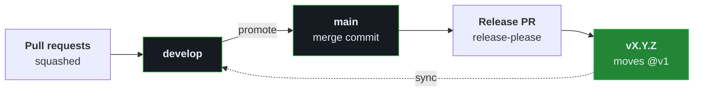

# Branching and releases

Back to the [README](../README.md).

## Branching and releases

1. Pull requests target `develop` and are squashed. The commit takes the PR title when a PR has
   several commits, and the commit's own subject when it has one, so CI requires a one-commit PR's
   title to match that subject.
2. A `chore: promote develop to main` pull request carries the bundle to `main`. Merge it with a
   **merge commit**, so [release-please](https://github.com/googleapis/release-please) sees each
   commit.
3. release-please opens a release pull request against `main`. Merging it tags `vX.Y.Z`, following
   [semver](https://semver.org/), and moves `@v1`. Promote first, then merge the release PR: a commit
   still on `develop` at that point is left out of the changelog for good.
4. A `chore: sync develop with vX.Y.Z` pull request copies the changelog, manifest and package files
   from `main` to `develop`. Separately, `sync-marketplace-pin.yml` opens the pull request in
   `SteerSpec/.claude` that moves the skills pin to the new release.

Title types set the version:

| Change | Title | Version |
| ------ | ----- | ------- |
| New capability | `feat:` | minor |
| Fix | `fix:` | patch |
| Docs and chores | `docs:`, `chore:` | no release |
| Rule-only change | `chore(rules):` | no release |

`@v1` always points at the latest `v1.x` release, so pinning it receives patches and
backward-compatible features automatically. Pin an exact `@vX.Y.Z` to upgrade manually.
